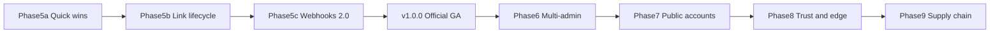
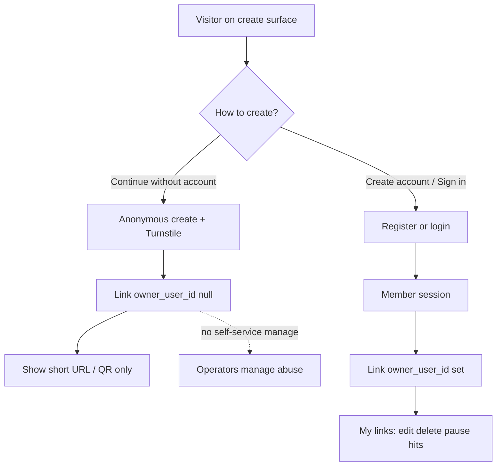

# Enhancements backlog & implementation roadmap

Phases 0–4 and trust/ops through **[v0.6.4](https://github.com/kyroskoh/url-shortener/releases/tag/v0.6.4)** are the last **beta** line. This roadmap turns every former Candidate plus first-class gap items (audit log, webhook event filter, edit parity, session revoke, **public user accounts** with **basic register and/or Social SSO**) into sequenced releases. Deferred/won’t-do rows stay out of scope (geo analytics, retries/DLQ, enterprise OIDC, K8s, multi-tenant billing, etc.). See [PRD.md](PRD.md) / [CHANGELOG.md](CHANGELOG.md).

## Versioning policy (beta → official)

| Line | Meaning |
|------|---------|
| **≤ v0.6.4** | Beta / pre-1.0 (current production) |
| **v1.0.0** | **First official release (out of beta)** — Phases 5a + 5b + 5c complete |
| **v1.1.0+** | Post-GA: multi-admin → public accounts → trust/edge → supply chain |

Do **not** publish v0.7 / v0.8 / v0.9. Land 5a→5b→5c on `main` (or prerelease tags `v1.0.0-rc.N` if needed), then cut **v1.0.0** once. Document stability: public redirect contract, admin REST, `@blink/client` / CLI, and env knobs are supported across 1.x with changelog’d breaks only.

Post-ship bugfixes → **patch** bumps on that line; re-run the verify gate before tagging.

### Per-phase test, verify, and version bumps (mandatory)

Every phase (5a, 5b, 5c, GA cut, 6, 7, 8, 9) must be **tested and verified before** treating that phase as done or advancing to the next:

| Gate | Required |
|------|----------|
| Unit / package tests | `npm test` (and phase-touched workspace tests) green |
| Typecheck | `npm run typecheck` green for touched packages |
| Integration / e2e | Phase-relevant Playwright or API integration coverage green when the phase touches UI/auth/redirect |
| Smoke | `npm run smoke` (or documented equivalent) against local compose when API/redirect behavior changes |
| Manual verify checklist | Short phase acceptance bullets checked off in CHANGELOG/PR notes |

**Do not** mark a phase complete, merge as “phase done,” or cut the phase’s release tag until the gate above passes.

**Bug fixes and version bumping:**

- Bugs found **during** a phase (before its release tag): fix in-phase; no separate version — still must re-run the gate.
- Bugs found **after** a phase ships (tagged release): ship a **patch** bump on that line (e.g. `v1.1.0` → `v1.1.1` for a Phase 6 fix; `v1.0.0` → `v1.0.1` for a GA regression). Document in CHANGELOG under the patch.
- Patch releases re-run the same verify gate for the affected surface; do not skip tests because “it’s only a fix.”
- Feature work for the *next* phase stays on the next minor (`v1.2.0`, …); do not bundle unrelated next-phase features into a bugfix patch.

---

## Agent handoff — current status

| Phase | Target | Status | Notes for next agent |
|-------|--------|--------|----------------------|
| **5a** | → v1.0.0 | **Done (unreleased)** | CLI/stats/abuse contact/bulk template; tests + typecheck green |
| **5b** | → v1.0.0 | **In progress / nearly done** | Code landed; finish verify (migrate `0004`, e2e/smoke), then mark Done |
| **5c** | → v1.0.0 | **Not started** | Webhooks 2.0 — next major coding slice after 5b gate |
| **GA** | **v1.0.0** | Blocked on 5a–5c | Tag + beta→stable docs |
| **6** | v1.1.0 | Planned | Multi-admin, API keys, audit, session revoke |
| **7** | v1.2.0 | Planned | Public accounts + Social SSO + linking |
| **8** | v1.3.0 | Planned | Safe Browsing, CF purge, www→apex |
| **9** | v1.4.0 | Planned | Docker Hub, rollback automation, Origin CA |

**Working tree:** Phase 5a/5b changes are largely uncommitted. Apply migration `apps/api/drizzle/0004_lifecycle.sql` (`active_at`) before runtime testing redirects/lifecycle.

---

## Roadmap (release sequence)



| Phase | Version target | Candidates / first-class work | Why this order |
|-------|----------------|-------------------------------|----------------|
| **5a** | → v1.0.0 | CLI parity; `GET /api/stats` + admin strip; `BLINK_ABUSE_CONTACT`; **bulk import CSV template** | Thin wrappers + docs/UX; no schema risk |
| **5b** | → v1.0.0 | Soft pause; `active_at`; duplicate `block`; **edit parity**; **import columns + template extended** | Shared `status` / link columns; redirect + edit/import |
| **5c** | → v1.0.0 | Webhook events beyond `hit`; **`BLINK_WEBHOOK_EVENTS` filter**; delivery status | Extends webhooks; fire-and-forget kept |
| **GA** | **v1.0.0** | Official release cut + docs (beta → stable) | First supported 1.x |
| **6** | v1.1.0 | Multi-admin invite + `admin`\|`viewer`; **per-account API keys**; **audit log**; **session revoke** | Operator auth first; OIDC **not** in this plan |
| **7** | v1.2.0 | Dual-path create; basic register **or** Social SSO; **link basic↔social**; My links; member API keys; Turnstile on throttle | Dual signup + explicit account linking |
| **8** | v1.3.0 | Safe Browsing; CF cache purge; www→apex | Trust + edge after account model settles |
| **9** | v1.4.0 | Docker Hub mirror; rollback automation; Origin CA | Supply-chain / deploy polish |

**Defaults locked:**

- Env-only policy knobs (no settings UI)
- Webhook delivery state in **Redis** (not a new Postgres table)
- Soft pause as third `links.status` value `paused`
- Duplicate policy via `BLINK_DUPLICATE_DESTINATION=warn|block` (default `warn`)
- Multi-admin adds Postgres `operators` while keeping `BLINK_PASSWORD` / env `BLINK_API_KEY` as bootstrap + **break-glass** machine auth
- **Per-account API keys** (operators, bootstrap admin, and members) stored hashed in Postgres
- Public end-users in `users` (not operators)
- **Create is dual-path** — anonymous (`BLINK_PUBLIC_MODE` + Turnstile) and/or registered members (`BLINK_PUBLIC_ACCOUNTS`)
- **Account actors** (member, operator, admin) who hit rate limits must pass Turnstile to continue (guest anonymous create still uses Turnstile per existing public rules); env break-glass key is **exempt**

Update this file’s statuses as each phase ships; add Phase 5–8 sections to [PRD.md](PRD.md) and release notes in [CHANGELOG.md](CHANGELOG.md). On the v1.0.0 cut, state clearly that Blink is out of beta.

---

## Shipped earlier (not open)

### Phase 3

- Hourly hit aggregates + admin chart (`GET /api/links/:slug/hits`)
- Hit webhooks with `X-Blink-Signature` HMAC-SHA256
- Idempotent create (`Idempotency-Key`)
- Cursor pagination on `GET /api/links`
- OpenAPI-aligned `@blink/client` + `blink` CLI
- Prometheus `/metrics`
- Per-link `maxHits` (edit may only increase or clear)

### Through v0.6.4

- Phase 4 ops (backups, GHCR, E2E); trust/ops harden; admin login + mobile UI

---

## Phase 5a — Quick wins (**Done**, part of v1.0.0)

### Acceptance (verified)

- [x] `blink get` / `quarantine` / `hits` CLI + client `get` / `setStatus`
- [x] Admin `GET /api/stats` + summary strip in admin UI
- [x] `BLINK_ABUSE_CONTACT` on quarantined/expired branded pages; [docs/ABUSE.md](docs/ABUSE.md)
- [x] Bulk import Load/Download template + [docs/examples/bulk-import.csv](docs/examples/bulk-import.csv) + [docs/API.md](docs/API.md)
- [x] `npm test -w @blink/api` + `npm run typecheck`

### 1. CLI parity: `blink get`, `quarantine`, `hits`

**Gap (resolved):** CLI had `create` / `list` / `delete` only. Client already had `hits`; missing `get` / status.

**Work:**

- `BlinkClient.get(slug)` and `BlinkClient.setStatus(slug, status)` calling `GET /links/:slug` and `POST /links/:slug/status`
- CLI: `get <slug>`, `quarantine <slug>` / `quarantine <slug> --clear` (re-enable → `active`), `hits <slug> [--from ISO] [--to ISO]`
- Usage text + client/CLI tests; docs in [docs/API.md](docs/API.md) / README CLI section

### 2. Instance stats API + admin summary strip

**API:** Admin-only `GET /api/stats`:

```ts
{
  totalLinks, activeLinks, pausedLinks?, quarantinedLinks,
  hitsToday, hits7d,
  topSlugs: [{ slug, hits }] // top 10 by links.hits
}
```

- `hitsToday` / `hits7d`: sum from `hit_aggregates`; fallback to `links.hits` only if aggregates empty for range
- Shared Zod DTO in `@blink/shared`; client method; OpenAPI if generated from shared

**UI:** When `authed`, fetch stats and render a compact summary strip above the “Your links” toolbar (totals + today/7d + top slugs as plain text/links — not a card dashboard).

### 3. `BLINK_ABUSE_CONTACT` on unavailable pages

- Config: `BLINK_ABUSE_CONTACT` (email or URL) + `.env.example`
- Render contact line on `quarantinedPage()` (and optionally `gonePage()`)
- Document public report path in [docs/ABUSE.md](docs/ABUSE.md)

### 3b. Bulk import CSV usage template

Canonical Phase 5a template (four columns; Phase 5b extends):

```csv
slug,destination,notes,expires_at
hello,https://example.com/welcome,Welcome link,
promo,https://example.com/sale?utm_source=blink,Summer promo,2026-12-31T23:59:59.000Z
,https://example.com/random-slug-ok,Empty slug = server generates,
```

**Usage:**

1. Keep the header row (`destination` required; others optional)
2. Datetimes: ISO-8601, `YYYY-MM-DD`, `YYYY-MM-DD HH:mm:ss`, or unix epoch; optional `timezone` for naive values; reject ambiguous `MM/DD`/`DD/MM`
3. Empty `slug` → API generates one
4. Admin UI: **Dry-run** then **Import**; or `POST /api/links/import?dryRun=true`
5. Quote fields with commas; UTF-8 (BOM stripped)

**UI:** “Load template” + optional “Download template.csv”; expand meta copy.

### Key files

- `packages/cli/src/cli.ts`, `packages/client/src/index.ts`
- `apps/api/src/links.ts` (`getInstanceStats`), `routes.ts` (`GET /stats`)
- `apps/api/src/branded-pages.ts`, `config.ts` (`abuseContact`)
- `apps/web/src/App.tsx` (stats strip, bulk import UX), `styles.css`
- `.env.example` — `BLINK_ABUSE_CONTACT`

---

## Phase 5b — Link lifecycle (**In progress**, part of v1.0.0)

### Scope

| Item | Intent | Implementation notes |
|------|--------|----------------------|
| Soft pause | `status`: `active` \| `paused` \| `quarantined` | Branded paused page `410`; admin Pause/Resume |
| `active_at` | Delayed activation | Column + create/edit UI; redirect `not_yet_active` until time |
| Duplicate policy | `BLINK_DUPLICATE_DESTINATION=warn\|block` | Default `warn`; `block` → 409 |
| Edit parity | Edit `expiresAt` + `activeAt` | Clear with null/empty |
| Bulk import | Columns + non-ISO dates + timezone | See below |

### 4. Soft pause

- Extend `linkStatusSchema` / DB check: `active` \| `paused` \| `quarantined` (migration `0004_lifecycle.sql`)
- Redirect: `paused` → branded page (“temporarily paused”), still `410` + `Cache-Control: no-store`
- Admin UI: Pause / Resume alongside Quarantine / Re-enable; status filter includes `paused`
- Webhooks (Phase 5c): emit `link.paused` when status set to paused (design payload now; fire once 5c lands)

### 5. `active_at` / delayed activation

- Column `links.active_at timestamptz null`; Zod `activeAt` on create/update; Advanced options datetime in create + edit form
- Redirect: if `active_at` is in the future → branded “not yet active” (410); do not increment hits; cache short TTL or no-store
- List/DTO expose `activeAt`

### 6. Duplicate-destination policy block

- Env `BLINK_DUPLICATE_DESTINATION=warn|block` (default `warn`)
- Create path `findDuplicates`: `block` → `409`; `warn` keeps `warnings: ["duplicate_destination"]`
- Expose mode on `GET /api/config` so UI can hint

### 6b. Edit parity for Advanced lifecycle fields

- Edit form: both `expiresAt` and `activeAt` (not create-only)
- Clear controls: empty/null clears `expiresAt` / `activeAt` (mirror maxHits clear semantics)
- Cover in API + e2e: create with dates → edit → redirect behavior matches

### 6c. Extend bulk import columns + refresh template

**Columns (order):** `slug,destination,notes,expires_at,active_at,timezone,max_hits`

```csv
slug,destination,notes,expires_at,active_at,timezone,max_hits
hello,https://example.com/welcome,Welcome link,,,,
promo,https://example.com/sale,Summer promo,2026-12-31T23:59:59.000Z,2026-06-01T00:00:00.000Z,UTC,1000
launch,https://example.com/go,Goes live later,,2026-07-01T09:00:00.000Z,Asia/Singapore,
```

- **Dates:** ISO-8601, `YYYY-MM-DD`, `YYYY-MM-DD HH:mm:ss`, unix epoch; reject ambiguous `MM/DD`/`DD/MM`
- **`timezone`:** `UTC` (default), `Local` (API host), abbreviations (`SGT`, …), or IANA (`Asia/Singapore`) — table in `@blink/shared` `IMPORT_TIMEZONE_REFERENCE`; admin **Timezone ?** hover next to Load/Download template
- **No `status` in CSV** (pause/quarantine stay admin actions)
- Backward compatible with original four-column files
- Aliases `activeAt` / `maxHits` via header normalize

### Key files (already touched)

- Migration: `apps/api/drizzle/0004_lifecycle.sql`
- `apps/api/src/db/schema.ts`, `links.ts`, `routes.ts`, `branded-pages.ts` (`pausedPage`, `notYetActivePage`), `import-csv.ts`
- `packages/shared` — `paused` status, `activeAt`, `import-timezones.ts`
- `apps/web` — pause UI, activeAt create/edit, timezone tip, `@blink/shared` dependency
- `.env.example` / INSTALLATION — `BLINK_DUPLICATE_DESTINATION`

### Remaining for 5b gate

- [ ] Run DB migrate / compose with `0004_lifecycle.sql`
- [ ] Smoke redirects: paused / not-yet-active / active
- [ ] Confirm duplicate `block` via create API
- [ ] Optional e2e touch for pause + import dry-run
- [ ] Mark this section **Done** and note in CHANGELOG when cutting toward v1.0.0

---

## Phase 5c — Webhooks 2.0 (**Not started**, part of v1.0.0)

### 7. Events beyond `hit`

Generalize `apps/api/src/webhooks.ts`:

| Event | When |
|-------|------|
| `hit` | Successful redirect (existing) |
| `link.created` | After create |
| `link.deleted` | After delete |
| `link.quarantined` | Status → quarantined |
| `link.paused` | Status → paused |
| `link.limit_reached` | Hit hits `maxHits` / one-time consume |
| `link.expired` | Redirect sees past `expiresAt` (once per resolve; acceptable duplicate under fire-and-forget) |

Shared envelope: `{ event, slug, at, shortUrl, ...eventSpecific }`. Keep `X-Blink-Signature` HMAC-SHA256. Still fire-and-forget `fetch` (no retries/DLQ).

### 7b. Webhook event filter

- Env `BLINK_WEBHOOK_EVENTS` — comma-separated allowlist (e.g. `hit,link.quarantined`). Empty/unset = **all** events (backward compatible)
- Parse in config; skip `fetch` when event not allowed
- Document in INSTALLATION / API.md; unit-test filter matrix

### 8. Webhook delivery status

- After each attempt, write Redis key `blink:webhook:last` JSON: `{ event, at, httpStatus, ok, error?, slug? }` (TTL none / long). Filtered-out events do not update status
- Admin `GET /api/webhooks/status` returns that snapshot (404/empty object if never sent)
- Show last delivery as a single line near the admin stats strip when authed — not a delivery log UI
- Tests: extend `webhooks.test.ts` with mocked fetch + Redis

### Key files to touch

- `apps/api/src/webhooks.ts`, `webhooks.test.ts`, call sites in `links.ts` / status routes
- `apps/api/src/config.ts`, `routes.ts`, `redis.ts`
- Docs: API.md, INSTALLATION, `.env.example`

---

## v1.0.0 — Official GA cut

After 5a–5c gates green:

1. Tag **v1.0.0**; GHCR publish
2. CHANGELOG “First official release”; README/PRD beta → stable
3. Update this file: 5a–5c **Done**; point to 1.1+ backlog
4. Keep Phase 6–9 as planned; Future consideration rows stay deferred

---

## Phase 6 — Multi-admin (v1.1.0)

**Not started.** OIDC deferred (enterprise IdP → Future consideration). Single shared password remains valid until operators are invited.

### Data model

New tables:

- `operators`: `id`, `email` (unique), `role` (`admin` \| `viewer`), `password_hash` (nullable until invite accepted), `invite_token_hash`, `invite_expires_at`, `session_version` (int, default 0), `created_at`, `updated_at`
- `api_keys`: `id`, `owner_kind` (`admin` \| `operator` \| `user`), `owner_id` (nullable for bootstrap `admin`), `name` (optional label), `key_prefix` (public hint, e.g. first 8 chars), `key_hash` (Argon2/SHA-256), `created_at`, `last_used_at`, `revoked_at` nullable

Migration `0005_operators.sql` (+ `api_keys` in same or follow-on migration) + Drizzle schema. Phase 7 only adds `owner_kind=user` rows; schema supports `user` from Phase 6.

### Auth behavior

- **Bootstrap:** If `operators` is empty, keep today’s `BLINK_PASSWORD` → session subject `"admin"` with implicit role `admin`; env `BLINK_API_KEY` remains **break-glass** full-admin machine key (not shown in UI; rotate via env)
- **Invite:** `POST /api/operators/invite` `{ email, role }` (admin-only) → create row + one-time token; response includes invite URL path `/invite/:token` (web) or token for email out-of-band (no SMTP required — return token once)
- **Accept invite:** `POST /api/operators/accept` `{ token, password }` → set hash, clear invite
- **Login:** If any operator exists with password, login accepts **email + password**; env password still works as break-glass bootstrap admin when configured
- **Session:** HMAC payload becomes `operatorId:role:sessionVersion:exp` (bootstrap keeps `admin`). Auth + `/auth/me` return `{ role, email? }`
- **RBAC:** `viewer` — GET list/get/hits/stats/config/webhooks status; deny create/edit/delete/status/import/invite. `admin` — full. Per-account API keys inherit the owner’s RBAC

### Per-account API keys (operators + bootstrap admin)

- Authenticated admin/operator (session): `POST /api/api-keys` `{ name? }` → returns **plaintext key once** + metadata; store only hash/prefix
- `GET /api/api-keys` — list own keys; admins may revoke any key; operators revoke own
- `DELETE /api/api-keys/:id` — revoke (soft `revoked_at`)
- Auth middleware: accept `X-API-Key` matching env break-glass **or** a non-revoked `api_keys` hash
- UI: “API keys” panel — Generate / copy-once warning / Revoke

### Session revoke

- On accept-invite password set, password change, role change, or operator revoke/delete: increment `session_version` so existing cookies fail immediately
- Changing `BLINK_SESSION_SECRET` remains global nuke (document in ABUSE.md)
- Tests: revoked operator cannot call admin routes with old cookie

### Admin audit log

- Table `audit_events`: `id`, `at`, `actor` (operator email or `env:admin` / `api-key`), `action` (e.g. `link.quarantine`, `link.pause`, `link.delete`, `link.create`, `operator.invite`, `operator.revoke`), `slug` nullable, `meta` jsonb nullable
- Write from mutating admin routes (best-effort; failures must not fail the primary action)
- Admin-only `GET /api/audit?cursor=&limit=` (viewer allowed read). No IP/UA fields
- Minimal admin UI: compact recent-actions list — not a full SIEM

### UI

- Login: email field when multi-admin mode (`/api/config` flag `multiAdmin: true` when operators.count > 0)
- Minimal Operators panel (admin): list emails/roles, invite form, revoke/delete
- Hide mutating controls for viewers (reuse `authed` + new `role`)
- Operator login UI stays distinct from Phase 7 public **register/login** pages

Reserved slugs already include `invite` / `users` — wire invite route without colliding with short links.

---

## Phase 7 — Dual-path create + public accounts (v1.2.0)

**Not started.** Depends on Phase 6 session patterns.

Visitors **choose** how to create links; account holders additionally **manage** theirs. Paths coexist when both flags are enabled (recommended for layurl.com-style public instances).



### Product rules

| Path | Who | Create requirements | After create | Manage later |
|------|-----|---------------------|--------------|--------------|
| **Anonymous** | Guest | `BLINK_PUBLIC_MODE=true` + Turnstile when configured / forced | Short URL + QR + copy; **unowned** (`owner_user_id` null) | **No** — operators handle quarantine/delete |
| **Account** | Registered member | `BLINK_PUBLIC_ACCOUNTS=true`; session cookie; **no** Turnstile on every create while under rate limit | Same success UX + link in **My links** | Yes — list/edit/delete/soft-pause/hits/QR + **API keys** for **own** links only |
| **Operator** | Admin / viewer | Existing admin auth / personal API key | Full admin surface | Full (all links); quarantine/import/stats/audit; **API keys** |

Neither path is mandatory when the other is available: UI must present **both** options clearly.

### Turnstile when rate-limited (account actors)

Applies to **members, operators, and bootstrap admin** (session or personal/`X-API-Key`), not a substitute for guest Turnstile on anonymous create.

1. Rate-limit buckets: prefer **per actor** (user id / operator id / api-key id), with IP as secondary
2. When over limit **without** a valid Turnstile token: `429` `{ error: "rate_limited", turnstileRequired: true }` (+ `Retry-After` if available)
3. Client: show Turnstile widget; retry with `turnstileToken` (body or `X-Turnstile-Token`)
4. Server: `verifyTurnstile`; on success, allow + short Redis grace so one solve is not demanded on every subsequent call
5. If Turnstile keys are not configured: keep classic `429` without challenge
6. **Locked:** env break-glass `BLINK_API_KEY` is **exempt** from Turnstile challenge (ops/CI); personal account keys are **not** exempt

### Defaults / config

| Knob / rule | Choice |
|-------------|--------|
| Anonymous create | `BLINK_PUBLIC_MODE` (existing); production should use `BLINK_TURNSTILE_FORCE=true` |
| Accounts | `BLINK_PUBLIC_ACCOUNTS=true` enables member sessions + My links |
| Local register | Enabled when accounts on (default); `BLINK_AUTH_LOCAL=true` |
| Social SSO | Optional providers via Passport; enable per provider when client id/secret set |
| Both on | Dual-path UI (default recommendation in INSTALLATION for public hosts) |
| Accounts only | No anonymous create; create form requires login |
| Public mode only | Today’s behavior; no Register nav |
| Identity store | Separate `users` table (not `operators`) |
| Quarantine / import / instance stats / audit / webhooks status | Operators only |
| Members may | Create, list, get, edit, delete, hits, soft-pause for **own** links; **not** quarantine |
| Claim anonymous later | **Out of scope** for v1.2 |
| Billing / orgs / enterprise OIDC | Out of scope |

### Account signup / sign-in methods

| Method | Details |
|--------|---------|
| **Basic registration** | Username **or** email (at least one; unique when present) + **strong password**. Policy: min 12 chars, ≥1 letter, ≥1 number; reject common passwords (embedded denylist). Hash with Argon2. No email verification in v1.2 |
| **Social SSO** | Passport OAuth: **Google** + **GitHub**. Env: `BLINK_OAUTH_GOOGLE_CLIENT_ID` / `_SECRET`, `BLINK_OAUTH_GITHUB_CLIENT_ID` / `_SECRET`, `BLINK_OAUTH_CALLBACK_BASE` (defaults to `BLINK_BASE_URL`). Provider shown only when configured |

### Account linking (bidirectional)

| Direction | Flow |
|-----------|------|
| **Basic → Social** | Logged in with password → “Connected accounts” → Connect Google/GitHub → OAuth `intent=link` with `state` bound to `user_id` → insert `user_identities` |
| **Social → Basic** | Social-only (`password_hash` null) → Set username/email (if missing) + strong password → `POST /api/auth/password` |
| **Auto-link on Social login** | OAuth email matches existing local user → attach identity; do **not** create duplicate |
| **Unlink social** | `DELETE /api/auth/identities/:provider` — only if another login method remains |
| **Remove local password** | Allowed only if ≥1 social identity remains |
| **Conflicts** | Provider identity already on another user → `409`; email/username taken → `409` |

APIs: `GET /api/auth/identities`; `GET /api/auth/oauth/:provider?intent=link`; `POST /api/auth/password`; unlink/delete-password with lockout checks. UI “Connected accounts” shows each provider + “Password: set / not set”.

### Data model

- Table `users`: `id`, `email` (unique, nullable), `username` (unique, nullable), `password_hash` (nullable for social-only), `session_version`, `created_at`, `updated_at` — CHECK: email IS NOT NULL OR username IS NOT NULL OR exists identity
- Table `user_identities`: `id`, `user_id` FK, `provider` (`google`\|`github`), `provider_user_id`, `created_at`; unique `(provider, provider_user_id)`
- Column `links.owner_user_id` uuid/text nullable FK → `users.id` (null = anonymous or operator-created)
- Migration `0006_public_users.sql` (+ index on `owner_user_id`)
- Create path: if member session → set `owner_user_id`; if guest public create → leave null

### API

- Guest create: existing `POST /api/links` under public mode + Turnstile (unchanged contract)
- `POST /api/auth/register` `{ email?, username?, password }` — strong-password validate; rate-limited
- `POST /api/auth/login` — `{ email or username, password }` → HttpOnly session `user:<id>:…` (distinct from operator/bootstrap)
- Social: `GET /api/auth/oauth/:provider` → redirect; callback → upsert identity/user → set session → redirect to My links
- `POST /api/auth/logout`, `GET /api/auth/me` — `{ kind: "user"|"operator"|"admin", email?, username?, role? }`
- Member create: same `POST /api/links` authenticated as user → ownership attached; Turnstile required after throttle
- Member API keys: same `POST/GET/DELETE /api/api-keys` as Phase 6, `owner_kind=user`
- List/get/update/delete/hits: scope by ownership when `kind === "user"`; operators see all; guests have **no** list API
- Bulk import: operators only
- `GET /api/config`: `publicMode`, `publicAccounts`, `authLocal`, `oauthProviders: ("google"|"github")[]`, Turnstile flags

### UI — choice + pages

**Home / create surface** (when `publicMode && publicAccounts` and not logged in):

- Primary create form remains for **anonymous** use (Turnstile when required)
- Adjacent CTAs: “Shorten without an account” and “Register or sign in to manage your links”
- Success for anonymous: one short sentence that the link cannot be managed later (+ optional Register CTA). No recovery token

**`/register` and `/login`:** brand-first dedicated pages (not the operator password panel)

- **Basic:** username and/or email + password (+ confirm on register); client-side strength hint
- **Social:** “Continue with Google” / “Continue with GitHub” when configured
- After success → **My links**

**My links** (member session): create form (no Turnstile until throttled) + list of own links + **API keys** panel; hide Operators, bulk import, quarantine, instance stats, audit

**Throttle UX:** on `turnstileRequired`, inline Turnstile on active form or small modal; retry after solve

**Nav:** when `publicAccounts` and logged out — Register / Sign in; when member — My links + Sign out; operator entry stays separate

nginx / SPA: `/login` and `/register` serve the web app; reserved slugs already include both; oauth callbacks under `/api/auth/oauth/...` only.

### Session revoke

- Same `session_version` bump on password change / account delete as operators
- Password reset via email **deferred** (no SMTP); operator can delete a user row to revoke

### Abuse / ops

- Rate-limit register + login; Turnstile on **guest create** (when forced) and on **register** when Turnstile configured
- Operators manage unowned + owned links for abuse; delete user → set `owner_user_id=null` (keep redirects)
- INSTALLATION: recommend `PUBLIC_MODE` + `PUBLIC_ACCOUNTS` + Turnstile force + URL checks; document the two visitor paths in README

### Tests / e2e

- Guest + Turnstile create → success → no My links access for that slug
- Basic register → login → create → My links → edit/delete own → 404 on another user’s slug
- Weak password rejected (unit + API)
- OAuth callback with mocked Passport profile → user + identity + session
- **Basic → social** and **Social → basic** linking; unlink/remove-password blocked when zero methods remain
- Conflict when identity/email owned by another user → 409
- Social login with matching email auto-links (no duplicate user)
- Member + admin/operator API keys; revoke → 401; env break-glass still works
- Force low rate limit: `429` + `turnstileRequired` → retry with token; env key exempt
- Logged-out UI shows both create paths when both flags on; accounts-only / public-only variants; social buttons only when configured
- Operator still lists unowned and owned links

---

## Phase 8 — Trust and edge (v1.3.0)

**Not started.**

### 9. First-party Google Safe Browsing

- Extend `apps/api/src/url-check.ts`: provider `safebrowsing` + `BLINK_SAFE_BROWSING_API_KEY` (`BLINK_URL_CHECK_PROVIDER=safebrowsing`)
- Call Safe Browsing v4 `threatMatches:find`; map matches → `{ ok: false, reason }`; timeouts fail closed (same as `http`)
- Document in ABUSE.md / INSTALLATION; keep `http` generic provider

### 10. Cloudflare cache purge helper

- Script `deploy/scripts/cloudflare-purge.mjs` using existing `cloudflare-lib.mjs`: purge by URL(s) or everything
- `deploy.yml` input `purge: skip | urls | everything` (default `skip`); optional `purge_urls`
- Document post-quarantine purge in CLOUDFLARE.md / ABUSE.md (no CF token in API process)

### 11. www → apex redirect

- In `cloudflare-provision.mjs`, upsert Dynamic Redirect / Bulk Redirect: `https://www.$DOMAIN/*` → `https://$DOMAIN/$1` (301), when `CLOUDFLARE_MANAGE_WWW` is enabled
- Document in CLOUDFLARE.md; dry-run prints planned rule

---

## Phase 9 — Supply chain (v1.4.0)

**Not started.**

### 12. Docker Hub mirror

- On `v*` publish in `.github/workflows/ci.yml`: after GHCR push, login Docker Hub (`DOCKERHUB_USERNAME` / `DOCKERHUB_TOKEN`) and push `blink-api` / `blink-web` same tags
- Document image names in INSTALLATION / DEPLOY; soft-skip if secrets absent so forks keep working

### 13. Deploy rollback automation

- Extend `deploy.yml`: input `rollback` (boolean). When true and `image_tag` empty/default, resolve previous published `v*` tag via `gh api` / git tags and set `BLINK_IMAGE_TAG`
- Keep manual `image_tag=vX.Y.Z` as primary; document in DEPLOY.md Rollback

### 14. Origin CA issuance automation

- Script `deploy/scripts/cloudflare-origin-ca.mjs`: create Origin CA cert via Cloudflare API, write cert/key paths used by nginx; `workflow_dispatch` / npm script `ops:origin-ca`
- Docs: alternative to Let’s Encrypt path in CLOUDFLARE.md (Full strict + Origin CA); do not remove `ensure-letsencrypt.sh`

---

## Cross-cutting

- **Tests / verify (mandatory per phase):** Coverage expectations: API unit/integration for stats, status/`active_at` redirect matrix, duplicate block, edit expires/activeAt, webhook events + filter + Redis status, RBAC, session revoke, audit writes, public register/ownership scoping, api_keys auth, rate-limit Turnstile for account actors; CLI smoke; e2e for pause/abuse contact/stats strip/multi-admin invite/public register+My links/API key generate where feasible (`e2e/admin-flows.spec.ts`)
- **Docs:** API.md (bulk-import template + curl, personal API keys, throttle+Turnstile); `docs/examples/bulk-import.csv`, INSTALLATION env table, ABUSE, CLOUDFLARE, DEPLOY, README; bump OpenAPI/`@blink/client` types each phase; v1.0.0 stability statement
- **Compatibility:** Existing single-admin deploys unchanged until operators are created; env `BLINK_API_KEY` remains valid break-glass; `BLINK_PUBLIC_ACCOUNTS` default false; webhook consumers must tolerate new `event` values and honor filters; status enum growth requires clients to accept `paused`
- **Post-ship fixes:** Patch version bumps per the versioning policy; re-verify before tagging

---

## Future consideration

Not in the current Phase 5–9 / v1.x implementation plan. Revisit when ops or product demand justifies it.

| Status | Idea | Notes |
|--------|------|-------|
| Idea | Enterprise OIDC for operators (generic IdP) | Phase 6 password invite; Phase 7 ships Passport social + local password — not full OIDC |
| Idea | Email verification + password-reset mail | After Phase 7 public accounts; needs SMTP / provider |
| Idea | Webhook retries / DLQ | Prefer fire-and-forget until delivery status proves need |
| Candidate | Outbound webhook HTTP timeout + circuit silence after N failures | Still no full retries/DLQ |
| Candidate | Scheduled Postgres backup cron / compose sidecar + off-host copy | Scripts exist (Phase 4); scheduling not automated |
| Candidate | Prometheus gauges mirroring instance stats | e.g. `blink_links_total{status=}`, hits today/7d |
| Idea | Public-create destination allowlist | Inverse of host blocklist for locked-down deployers |
| Idea | Slack / Discord webhook presets, Zapier-style connectors | Prefer generic HMAC webhooks |
| Idea | A/B destinations, link trees, branded domains per link | Product expansion |
| Idea | SaaS billing / orgs / multi-tenant tenancy | PRD non-goal; self-hosted dual-path accounts ≠ billing |
| Idea | Claim anonymous slug into a user account | Explicitly out of Phase 7 |

## Won’t do (for now)

| Status | Idea | Notes |
|--------|------|-------|
| Won’t do | Geo / IP / UA analytics | PRD Phase 3 non-goal |
| Won’t do | Tracking pixels, marketing cookies | Product non-goals |
| Won’t do | Kubernetes operator, multi-region active-active | Phase 4 non-goals |

---

## Suggested next-agent sequence

1. **Finish Phase 5b gate** — migrate `0004`, smoke lifecycle redirects, duplicate block, mark Done here.
2. **Implement Phase 5c** — webhooks events + filter + Redis status (file list above).
3. **GA v1.0.0** — CHANGELOG/README/PRD + tag (only after 5a–5c verified).
4. Continue **6 → 7 → 8 → 9** per sections above; keep Future consideration out of scope unless reprioritized.

---

## Acknowledgments

- Inspired by [chhoto-url](https://github.com/SinTan1729/chhoto-url)
- Live at [layurl.com](https://layurl.com)
- Community feedback and contributions

## Support

- Issues: [GitHub Issues](https://github.com/kyroskoh/url-shortener/issues)
- Discussions: [GitHub Discussions](https://github.com/kyroskoh/url-shortener/discussions)

---

Made with ❤️ by [Kyros Koh](https://github.com/kyroskoh)
